# Architecture: how the components connect

```mermaid
flowchart TD
  main[main.jsx] --> Providers[ThemeContext / DialogContext / ErrorBoundary]
  main --> App[App.jsx router]

  App --> Landing[LandingPage / SetupScreen / SupabaseGuide / MigrationScreen]
  App --> Gate[LocalAuthGate / AuthorizeHub]
  App --> Public[Public pages: PublicMenu / PublicOrder / PublicCFDI / PublicEnroll]
  App --> Register[Register.jsx - cashier POS]
  App --> Admin[Admin.jsx - back office]

  subgraph RegisterUI[components/register]
    Layouts[CafeLayout / OrderFlowLayout / FloorLayout]
    Ticket[TicketArea / MenuArea]
    Modals[Checkout / Modifier / Loyalty / Discount / Expense / Corte / PinChallenge / SyncStatus]
    Lock[BootScreen / LockScreen]
    Inbox[OnlineOrdersInbox]
  end
  Register --> RegisterUI

  subgraph AdminUI[components/admin - tabs]
    Tabs[Analytics / Orders / MenuEditor / Menus / Modifiers / Recipes / Inventory / Vendors / Tables / Team / Loyalty / Discounts / Tips / CFDI / Devices / Activity / Settings]
  end
  Admin --> AdminUI
  Tabs --> Canvas[menuCanvas: CanvasEditor / CanvasRenderer]
  Tabs --> Floor[floor/FloorEditor]

  subgraph State[State and hooks]
    Stores[zustand: useAuthStore / useCartStore / useMenuStore / useUpgradeNagStore]
    Hooks[hooks: useCheckout / useTickets / useSyncQueue / useShiftCorte / useLoyalty / useExpenses / usePresence ...]
  end
  Register --> Stores
  Register --> Hooks
  Admin --> Stores

  subgraph Services[services]
    Checkout[checkoutService / inventoryService / reopenService]
    Sync[syncService / salesSync / ticketSync / expenseSync]
    Online[onlineOrders / orderAlerts]
    Other[activityService / tipsService / vendorPayoutsService / localToCloudMigration]
  end
  Hooks --> Services
  Admin --> Services

  subgraph DataAPI[src/api - local vs cloud adapters]
    Adapters[menu / floors / vendors / menus / menuImages / menuVersions]
    Local[*Local.js]
    Cloud[*Cloud.js]
  end
  Register --> Adapters
  Admin --> Adapters
  Adapters -->|appMode = local| Local
  Adapters -->|appMode = cloud| Cloud

  Utils[utils: posMath / discountEngine / appMode / network / realtime ...]
  Register --> Utils
  Services --> Utils

  Dexie[(db.js - Dexie IndexedDB 'TinyPOS_DB')]
  SB[supabaseClient.js]
  Local --> Dexie
  Services --> Dexie
  Cloud --> SB
  Services --> SB
  Public --> SB

  subgraph Vercel[Vercel serverless /api + middleware.js]
    Auth[auth/start + auth/callback - Supabase OAuth]
    Prov[supabase.js / install.js - project provisioning, run SQL, keys]
    Misc[add-device / domains / log-error]
  end
  Landing -->|fetch /api/*| Vercel
  Admin -->|fetch /api/*| Vercel

  Supabase[(Supabase Postgres + RLS + RPCs<br/>db/migrations)]
  SB --> Supabase
  Prov --> Supabase
  SW[public/push-sw.js] -.->|push alerts| Inbox
  Online -.->|realtime| Supabase
```

**Key ideas**
- `App.jsx` routes between onboarding, public customer pages, the cashier `Register`, and the `Admin` back office.
- Data goes through `src/api/*` adapters, which pick `*Local.js` (Dexie/IndexedDB, offline) or `*Cloud.js` (Supabase) based on `utils/appMode`.
- Sales, tickets and expenses are written locally first and pushed to Supabase by the sync services.
- `/api/*` Vercel functions handle Supabase OAuth, project provisioning/migrations, custom domains, devices and error logging.
